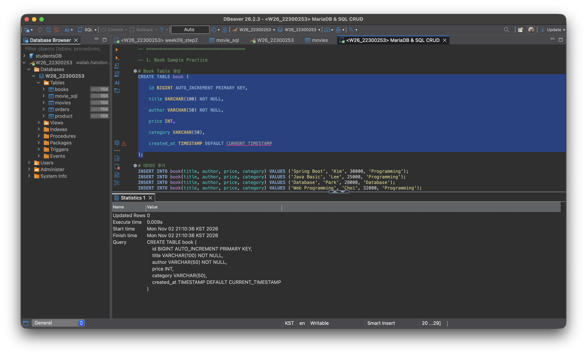
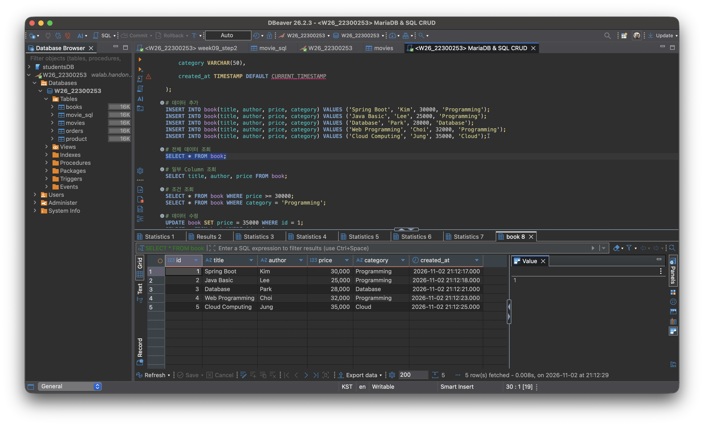

## 1. 프로젝트 소개

### 주제

무비 데이터 관리 시스템

crud 기능 수행

### Entity 필드 구조

| Field       | Type    |
|-------------|---------|
| id          | Long    |
| title       | String  |
| director    | String  |
| genre       | String  |
| rating      | Double  |
| releaseYear | Integer |

### 프로젝트 구조 및 개발 환경

```text
week09_jpa_project/
├── src/main/java/org/example/week09_jpa_project/
│   ├── controller/
│   ├── service/
│   ├── repository/
│   ├── entity/
│   └── dto/
├── src/main/resources/
│   └── application.properties
├── build.gradle
├── Dockerfile
└── README.md
```

| 구분            | 기술                          |
|---------------|-----------------------------|
| Language      | Java 21                     |
| Framework     | Spring Boot                 |
| Build Tool    | Gradle                      |
| Database      | MariaDB                     |
| ORM           | Spring Data JPA / Hibernate |
| Database Tool | DBeaver                     |
| API Test      | Postman                     |
| Deployment    | Render / Docker             |

- **GitHub Repository:** https://github.com/2026-2-WebService/assign09-c01-22300253.git
- **Render Deployment URL:** https://two026web-assign9.onrender.com

---

## 2. Database SQL Practice

### 기존 Table 조회 및 데이터 추가

movie_sql:

```text
CREATE TABLE movie_sql (
    id BIGINT AUTO_INCREMENT PRIMARY KEY,
    title VARCHAR(100) NOT NULL,
    director VARCHAR(100),
    genre VARCHAR(50),
    rating DOUBLE
);

INSERT INTO movie_sql(title, director, genre, rating)
VALUES
    ('Inception', 'Nolan', 'SF', 9.1),
    ('Interstellar', 'Nolan', 'SF', 9.3),
    ('Parasite', 'Bong', 'Drama', 9.0);


SELECT * FROM movie_sql;

UPDATE movie_sql
SET rating = 9.5
WHERE title = 'Interstellar';

SELECT * FROM movie_sql;

DELETE FROM movie_sql
WHERE title = 'Parasite';

SELECT * FROM movie_sql;

SELECT title, rating FROM movie_sql;

SELECT * FROM movie_sql WHERE genre = 'SF';
```

**실행 결과**

## Database SQL Practice

- 기존




### 새로운 Table 조회 및 데이터 추가

```text
CREATE TABLE movie_sql (
    id BIGINT AUTO_INCREMENT PRIMARY KEY,
    title VARCHAR(100) NOT NULL,
    director VARCHAR(100),
    genre VARCHAR(50),
    rating DOUBLE
);

INSERT INTO movie_sql(title, director, genre, rating)
VALUES
    ('Inception', 'Nolan', 'SF', 9.1),
    ('Interstellar', 'Nolan', 'SF', 9.3),
    ('Parasite', 'Bong', 'Drama', 9.0);


SELECT * FROM movie_sql;

UPDATE movie_sql
SET rating = 9.5
WHERE title = 'Interstellar';

SELECT * FROM movie_sql;

DELETE FROM movie_sql
WHERE title = 'Parasite';

SELECT * FROM movie_sql;

SELECT title, rating FROM movie_sql;

SELECT * FROM movie_sql WHERE genre = 'SF';
```

**실행 결과**


--- 

## Spring Data JPA 구현

### Entity 및 JpaRepository 설명

Entity는 Java 객체와 데이터베이스 테이블을 매핑하는 역할

JpaRepository는 Entity를 데이터베이스에 저장하거나 조회·수정·삭제할 수 있도록 기본 CRUD 메서드를 제공하는 인터페이스

### JPA Annotation

- @Entity : JPA가 관리하는 Entity 클래스로 지정
- @Table : Entity와 연결할 DB 테이블 이름 지정
- @Id : 기본 키(Primary Key) 지정
- @GeneratedValue :    기본 키 자동 생성 방식 지정
- @Column :    컬럼의 이름과 제약조건 설정
- @NotBlank    : null, 빈 문자열, 공백만 있는 문자열을 허용하지 않음
- @NotNull : null을 허용하지 않음
- @Size(max = 100) : 문자열 길이를 최대 100자로 제한
- @PositiveOrZero : 숫자가 0 이상인지 검증

### REST API Endpoint 목록 및 요청·응답 JSON

| Method | Endpoint         |
|--------|------------------|
| POST   | /api/movies      |
| GET    | /api/movies      |
| GET    | /api/movies/{id} |
| PUT    | /api/movies/{id} |
| DELETE | /api/movies/{id} |

- post 및 put
  요청

```json
{
  "title": "Interstellar",
  "director": "Nolan",
  "genre": "SF",
  "rating": 9.3,
  "releaseYear": 2014
}
```

응답

```json
{
  "id": 3,
  "title": "Interstellar",
  "director": "Nolan",
  "genre": "SF",
  "rating": 9.3,
  "releaseYear": 2014
}
```

나머지는 url를 통해

### JPA Entity와 MariaDB Table 비교

| 구분        | JPA Entity              | MariaDB Table          |
|-----------|-------------------------|------------------------|
| 형태        | Java 클래스| DB 테이블               |
| 역할        | 객체 형태의 데이터 표현 | 실제 데이터 저장       |
| 기본 키	   | @Id	                    | PRIMARY KEY            |
| 자동 ID 생성  | @GeneratedValue	        | AUTO_INCREMENT         |
| 컬럼 설정     | @Column	                | VARCHAR, INT 등         |
| 구조 변경     | Java 코드 및 Annotation 수정 | DDL 실행 또는 Hibernate 반영 |
| 데이터 접근    | Java 객체와 Repository     | SQL                    |       

---

## JPA vs SQL
| 메서드 | 기능 | SQL 명령어 | 실제 실행 결과 |
|---|---|---|---|
| `save()` | 영화 등록 | INSERT | [작성] |
| `findAll()` | 전체 영화 조회 | SELECT | [작성] |
| `findById()` | 특정 영화 조회 | SELECT WHERE | [작성] |
| `save()` | 기존 영화 수정 | UPDATE | [작성] |
| `deleteById()` | 특정 영화 삭제 | DELETE | [작성] |

### Hibernate SQL 확인
```text
Hibernate: 
    select
        m1_0.id,
        m1_0.director,
        m1_0.genre,
        m1_0.rating,
        m1_0.release_year,
        m1_0.title 
    from
        movies m1_0
Hibernate: 
    insert 
    into
        movies
        (director, genre, rating, release_year, title) 
    values
        (?, ?, ?, ?, ?)
Hibernate: 
    select
        m1_0.id,
        m1_0.director,
        m1_0.genre,
        m1_0.rating,
        m1_0.release_year,
        m1_0.title 
    from
        movies m1_0 
    where
        m1_0.id=?
Hibernate: 
    select
        m1_0.id,
        m1_0.director,
        m1_0.genre,
        m1_0.rating,
        m1_0.release_year,
        m1_0.title 
    from
        movies m1_0
Hibernate: 
    select
        m1_0.id,
        m1_0.director,
        m1_0.genre,
        m1_0.rating,
        m1_0.release_year,
        m1_0.title 
    from
        movies m1_0 
    where
        m1_0.id=?
Hibernate: 
    select
        m1_0.id,
        m1_0.director,
        m1_0.genre,
        m1_0.rating,
        m1_0.release_year,
        m1_0.title 
    from
        movies m1_0 
    where
        m1_0.id=?
Hibernate: 
    update
        movies 
    set
        director=?,
        genre=?,
        rating=?,
        release_year=?,
        title=? 
    where
        id=?
Hibernate: 
    select
        count(*) 
    from
        movies m1_0 
    where
        m1_0.id=?
Hibernate: 
    select
        m1_0.id,
        m1_0.director,
        m1_0.genre,
        m1_0.rating,
        m1_0.release_year,
        m1_0.title 
    from
        movies m1_0 
    where
        m1_0.id=?
Hibernate: 
    delete 
    from
        movies 
    where
        id=?
Hibernate: 
    select
        m1_0.id,
        m1_0.director,
        m1_0.genre,
        m1_0.rating,
        m1_0.release_year,
        m1_0.title 
    from
        movies m1_0
Hibernate: 
    select
        m1_0.id,
        m1_0.director,
        m1_0.genre,
        m1_0.rating,
        m1_0.release_year,
        m1_0.title 
    from
        movies m1_0 
    where
        m1_0.id=?
```

## 배포 및 환경 설정

### IntelliJ 및 Render 환경변수 설정 방법(변수명만 기록)

- DB_URL     
- DB_USERNAME    
- DB_PASSWORD


### MariaDB 데이터 저장 확인


### 발생한 문제와 해결 방법

없었습니다

## Weekly Report

###  Key Learning

1. Spring Data JPA와 Hibernate의 역할
  - `save()`, `findAll()`, `findById()`, `deleteById()` 등의 메서드를 통해 직접 sql 문을 작정하는 것이 아니라 Hibernate가 필요한 SQL을 생성후  실행

2. Request DTO에서 검증 방법
  - Request DTO에 `@NotBlank`, `@NotNull`, `@Size`, `@PositiveOrZero`을 통해 입력 검증 가능
  - Controller에서 `@Valid`를 넣어 요청 데이터가 Service로 전달되기 전에 검증 진행

3. Entity와 데이터베이스의 관계
  - `@Entity`, `@Table`, `@Column` 를 이용하여 Java 객체와 MariaDB 테이블 생성 진행

### Problem & Solution

**Problem**

MovieRequest DTO에서 `@NotBlank`, `@NotNull`, `@PositiveOrZero` 등의 Validation Annotation을 사용했을 때 에러 발생

**Solution**

처음에는 import 문제라고 생각했지만, build.gradle을 확인한 결과 Spring Boot Validation 의존성이 추가 필요

### Code Review

```java
@DeleteMapping("/{id}")
public ResponseEntity<Void> delete(@PathVariable Long id) {
  ms.delete(id);
  return ResponseEntity.noContent().build();
}
```
기존 ResponseStatus 를 통해 상태 코드를 전송했다면 이번엔 다른 방식으로 표현 한다는 점에서 의의가 있다.


AI usage
- 코드 이해를 위한 주석 - 교수님 기본 코드 베이스
- 기본적인 수정 사항 찾기
- readme에서 관련 자료 table로 표현하기